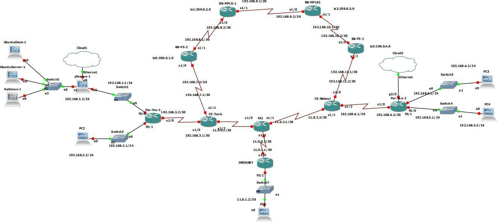

# Secure multi-site enterprise network (GNS3)

Academic project, ISET Nabeul (November 2025). A virtual enterprise network built in GNS3 and
VirtualBox: two company sites connected through a service provider's MPLS backbone, an encrypted
backup link between the sites, a protected server network, and a penetration test of the result.

## Architecture

| Part | Devices | What it does |
|---|---|---|
| Provider backbone | BB-MPLS-1, BB-MPLS2, BB-PE-1, BB-PE-2 | MPLS L3VPN carrying the customer's traffic between sites |
| Customer sites | CE-Tunis, CE-Nabeul | Edge routers of the Tunis and Nabeul sites |
| Site routers | Par-feu-1, Pare-feu-2 | Internal routing towards each site's LANs |
| Internet zone | FAI, INTERNET | Simulated ISP and Internet, used for the backup path and outbound access |
| Server network | pfsense-1, UbuntuServer-1, UbuntuDesk-1, KaliLinux-1 | Firewall, services, test client and attacker machine (VirtualBox VMs) |

All router configurations are in [`configs/routers`](configs/routers) (Cisco 7200, IOS 15.2).

### Provider backbone

- **OSPF** (area 0) between the four backbone routers, advertising core links and loopbacks.
- **MPLS with LDP** on the core links, using loopbacks as LDP router IDs.
- A **VRF** (`hightech`, RD 100:1, RT 1:100) on each PE router holds the customer routes.
- **MP-BGP** (VPNv4) between the two PE routers, peering over their loopbacks, carries those routes
  across the backbone.
- **EIGRP** runs between each PE and its CE inside the VRF; EIGRP and BGP are redistributed into
  each other on the PE routers.

### Backup link between sites

CE-Tunis and CE-Nabeul are also connected by a **GRE tunnel protected by IPsec**, built over the
simulated Internet. Each CE has a static summary route (/22) to the other site through the tunnel,
while the more specific /24 routes arrive through the MPLS VPN. Traffic therefore uses the MPLS path
normally, and falls back to the tunnel when the /24 routes disappear.

Each CE also performs **NAT overload** for Internet access, with an ACL that excludes traffic
between the two sites from translation.

### Server network (behind pfSense)

**pfSense** protects the 10.10.10.0/24 server network:

- firewall rules controlling traffic between the server network, the rest of the lab and the Internet;
- outbound NAT and a DHCP server for the LAN;
- **Snort** IDS/IPS monitoring LAN traffic, with the Snort Subscriber, GPLv2 Community, Emerging
  Threats Open and OpenAppID rule sets.

**UbuntuServer-1** (10.10.10.20) hosts the services ([`configs/servers`](configs/servers)):

| Service | Software | Notes |
|---|---|---|
| VoIP | Asterisk | SIP extensions 1000, 2000, 2001; guests disabled, access limited to the LAN |
| File transfer | vsftpd | Local users only, chroot, passive port range 30000-31000 |
| Web | nginx + Apache2 | nginx on port 80 balancing (least connections) over three nginx backends and Apache |
| Logging | rsyslog | Receives logs from other machines on UDP/TCP 514 |
| Host firewall | UFW | Services allowed from the LAN only |
| Brute-force protection | Fail2Ban | SSH and FTP jails, ban after 3 failures for 1 hour, using UFW |

Services were tested from **UbuntuDesk-1**: SIP registration and calls with Zoiper, file transfers
with FileZilla.

## Penetration test

Run from **KaliLinux-1** against the server network:

| Test | Tool | Finding | Fix |
|---|---|---|---|
| Password brute force on SSH and FTP | Hydra | Unlimited login attempts; credentials recovered with a dictionary | Fail2Ban jails: 3 failures, 1 hour ban |
| HTTP flood | DDoS-Ripper | A single web server was a single point of failure | nginx load balancing across several backends |
| Known service vulnerabilities | Metasploit | No exploitable vulnerability identified | - |

After the fixes, Hydra attempts were blocked by Fail2Ban, and the web service remained available
during the HTTP flood. In this lab all web backends run on the same virtual machine; in a real
deployment they would run on separate servers, so the load balancing also protects against the
failure of one server.

## Known weaknesses and what I would change

Reviewing the configuration after the project, these are the points I would fix:

- **IPsec uses 3DES and MD5** (`esp-3des esp-md5-hmac`), both deprecated, with a weak pre-shared key.
  I would use AES-256 with SHA-256 (or IKEv2 with AES-GCM) and a long random key or certificates.
- **SSH is open from anywhere** in UFW (IPv4 and IPv6), while every other service is LAN-only.
  It should be limited to an administration network.
- **The Fail2Ban SSH jail path is missing a leading slash** (`var/log/auth.log`), so that jail
  relies on Ubuntu's default settings to find the log.
- **nginx still allows TLS 1.0 and 1.1** (Ubuntu's default `ssl_protocols` line). Only TLS 1.2 and
  1.3 should be enabled.
- **The site routers (Par-feu-1, Pare-feu-2) have no filtering**; only the server network is behind a
  stateful firewall. ACLs or a zone-based firewall would protect the other LANs.
- **No encryption on VoIP** (`encryption = no`). SIP over TLS with SRTP would protect calls.
- Lab passwords in the configuration files are intentionally simple; they were the targets of the
  brute-force tests.

## Tools

GNS3, Cisco IOS (c7200), VirtualBox, pfSense, Snort, Ubuntu Server 22.04, Ubuntu Desktop, Kali Linux,
Asterisk, vsftpd, nginx, Apache2, rsyslog, UFW, Fail2Ban, Hydra, Metasploit, DDoS-Ripper.
